<div align="center">


# Gourwest Ordering Site

**A production-grade restaurant ordering site you can clone and make your own.**<br />
Menu, bowl customiser, pickup checkout, loyalty tiers and an AI menu concierge, built with Astro and Cloudflare Pages Functions.

[](https://github.com/TCWuraGroupCapital/Gourwest-Ordering-Simulator/actions/workflows/ci.yml)
[](LICENSE)


[Quick start](#quick-start) · [Screenshots](#screenshots) · [Features](#features) · [Make it yours](#make-it-yours) · [Architecture](#architecture) · [Deploy](docs/DEPLOYMENT.md)

</div>

<picture>
  <source media="(prefers-color-scheme: dark)" srcset="docs/screenshots/home-desktop-dark.jpg" />
  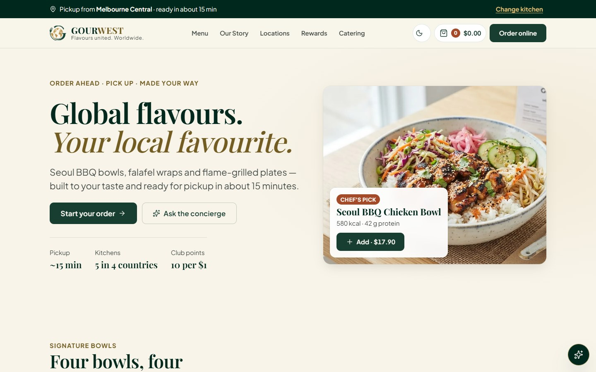
</picture>

> [!NOTE]
> **Gourwest is a fictional brand.** Menu, prices, kitchens and loyalty members are demo data, and no payments are
> taken. The whole site ships with `X-Robots-Tag: noindex` so a clone never shows up in search by accident.

## Quick start

Requires **Node 22.23.4+**.

```bash
git clone https://github.com/TCWuraGroupCapital/Gourwest-Ordering-Simulator.git
cd Gourwest-Ordering-Simulator
npm ci
npm run dev        # UI only → http://localhost:4321
```

For the full site with its API routes in the Cloudflare runtime:

```bash
cp .dev.vars.example .dev.vars   # Windows: copy .dev.vars.example .dev.vars
npm run preview                  # site + functions → http://localhost:8788
```

No keys are needed to browse, customise and fill the bag. The concierge answers from a built-in recommender until
you add an AI key, and checkout needs a back-office endpoint (see [Make it yours](#make-it-yours)).

## Screenshots

| Menu | Customiser |
| --- | --- |
| 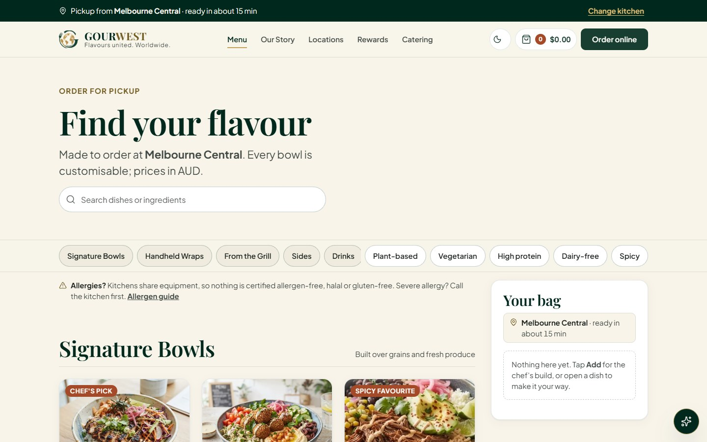 | 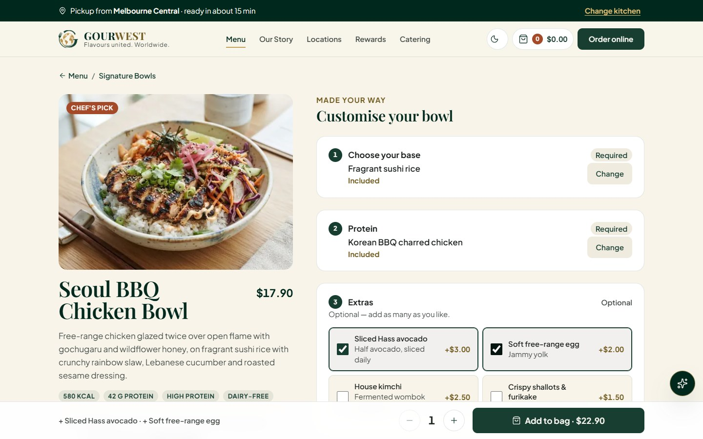 |
| **AI menu concierge** | **Bag and pickup checkout** |
| 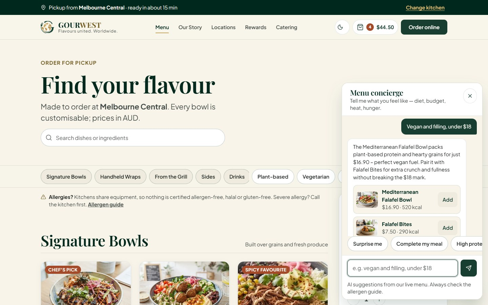 | 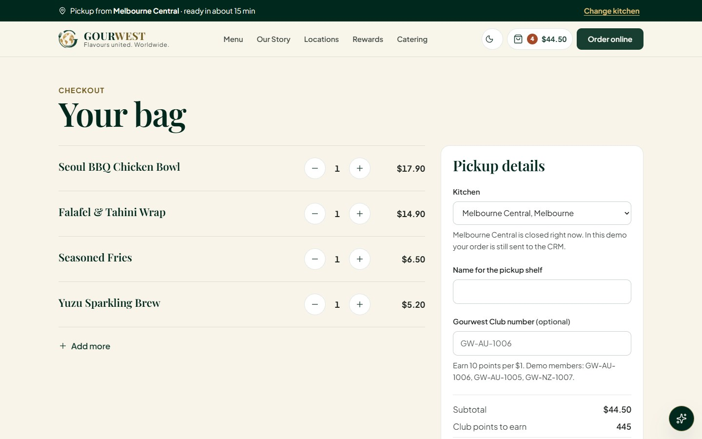 |
| **Loyalty tiers** | **Allergen matrix** |
| 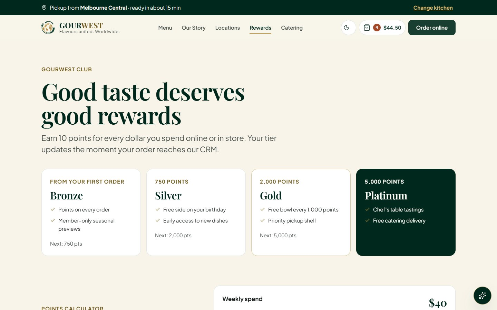 | 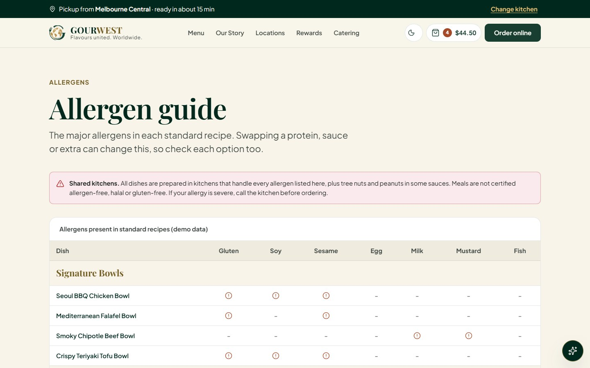 |

<details>
<summary><strong>Mobile</strong> (390 × 844)</summary>
<br />

| Home | Menu | Customiser | Bag |
| --- | --- | --- | --- |
| 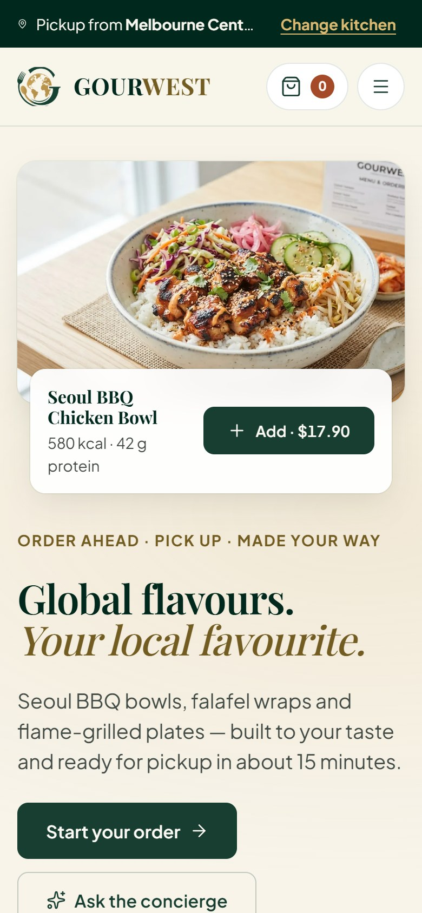 | 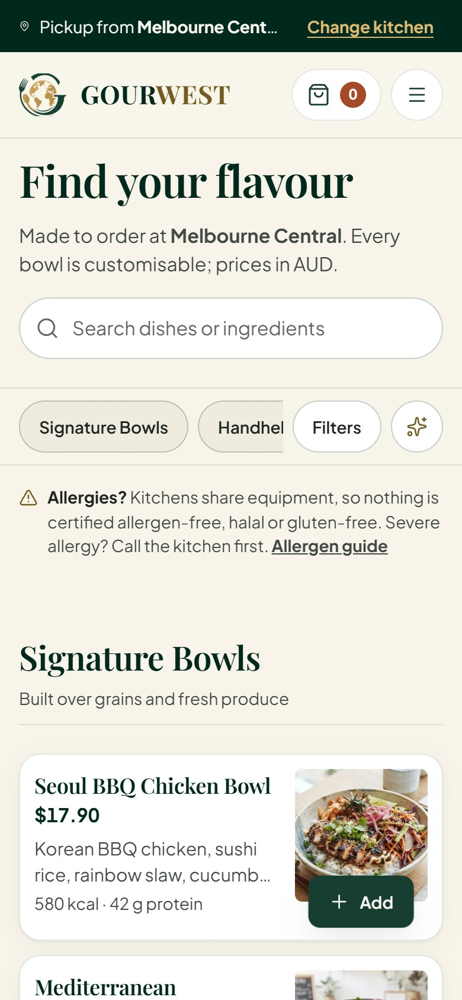 | 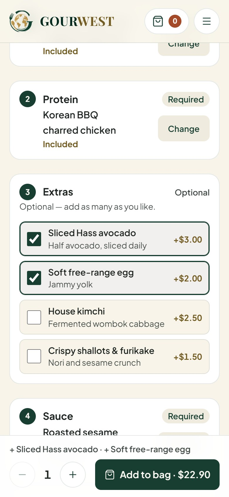 | 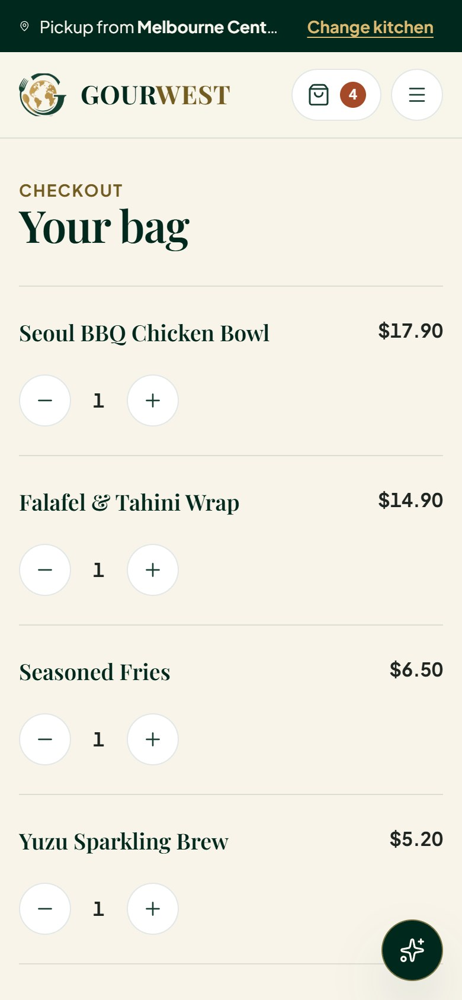 |

</details>

## Features

**Ordering**
- Menu with search, category chips and dietary filters, driven by one data file
- Step-by-step customiser (base, protein, extras, sauce) with live pricing and a sticky "Add to bag" bar
- Bag that persists across pages and tabs, a pickup checkout, and a pickup tracker with a header countdown
- "Your usual": one-tap reorder of the last order, stored on the device without personal details

**Loyalty and AI**
- Four-tier loyalty club with a points calculator and a tier-progress nudge at checkout
- Menu concierge: Groq first, NVIDIA NIM as fallback, then a built-in recommender, so it always answers. It sees
  the bag and the kitchen's local time, and its picks go into the bag with one "Add all" tap

**Brand and content**
- 3D kitchen globe (three.js), five demo kitchens with local opening hours, our story, catering and contact pages
- Allergen matrix generated from the menu, so it can't drift from the recipes
- Light and dark themes, responsive layouts, reduced-motion support

**Engineering**
- Server re-prices every order; client totals are ignored
- HMAC-SHA256 signed webhooks, idempotent checkout and a KV outbox that keeps taking orders through back-office outages
- Strict CSP with build-time script hashes, Turnstile bot checks, same-origin and honeypot guards
- JSON-LD `@graph` per page, answer-first FAQs, sitemap and `/llms.txt`
- Type-checked end to end, with Vitest suites and a CI pipeline that deploys to Cloudflare Pages

## Make it yours

| To change | Edit |
| --- | --- |
| Colours, type, spacing | `src/styles/tokens.css` (design rationale in `design/warm_editorial_hospitality/DESIGN.md`) |
| Logo, app icons, share image | `public/brand/` and `public/favicon*` |
| UI icon set (Lucide) | `NAMES` in `scripts/build-icons.mjs`, then `node scripts/build-icons.mjs` |
| Dishes, options and prices (cents) | `src/data/menu.ts` |
| Food photos | `public/images/food/<name>-640.webp` and `<name>-1200.webp` |
| Kitchens, addresses, hours | `src/data/stores.ts` |
| Loyalty tiers | `src/data/club.ts` |
| Where orders go | `functions/_lib/crm.ts` (any HTTPS endpoint that accepts the signed events below) |

The menu file drives the pages, the bag, the server-side price check, the allergen matrix, the concierge prompt and
the structured data, so one edit updates all of them. The tests check that every default option still prices correctly.

## Architecture

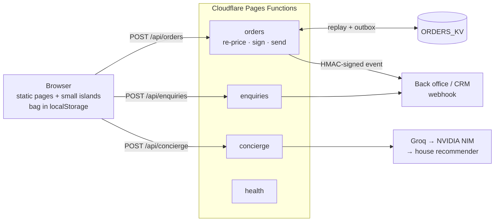

**Order flow.** Each checkout gets one id, so a double click can't send it twice. The function re-prices the bag from
`src/data/menu.ts`, signs the raw body with `X-Gourwest-Signature: sha256=<HMAC-SHA256(body, GOURWEST_WEBHOOK_SECRET)>`
and posts it to `{CRM_BASE_URL}/api/gourwest/webhooks/online_ordering`. If the back office is down, slow or busy, the
order is still accepted (HTTP 202) and its event waits in `ORDERS_KV` under `outbox:<ref>`. It is resent with the same
reference on later API traffic until the back office confirms.

**Secrets stay server-side.** The browser never sees the webhook secret or AI keys and never calls the back office.
`GET /api/health` reports which integrations are configured, never their values.

## Tech stack

| Layer | Choice |
| --- | --- |
| Site | [Astro 7](https://astro.build) static output, TypeScript, plain CSS with design tokens |
| 3D | [three.js](https://threejs.org) globe from Natural Earth land points |
| API | Cloudflare Pages Functions, Workers KV, Turnstile |
| Validation | Typed parsers on every API body; [Zod](https://zod.dev) for structured AI output |
| AI | Groq (`openai/gpt-oss-120b`), NVIDIA NIM fallback, built-in recommender |
| Quality | `astro check`, `tsc`, [Vitest](https://vitest.dev), GitHub Actions, Dependabot |

## Quality gates

```bash
npm run verify   # astro check + functions/tests type-check + Vitest + production build with CSP hashing
```

The 98 tests cover pricing, tampering and size limits, the recommender, shared field rules, the HMAC (checked against
Node's own implementation), idempotent replay, queuing and resending through outages, auth and origin guards,
enquiry handling, structured data and the concierge fallback. CI runs the same command on every push and pull request.

## Project layout

```
src/data/        menu, kitchens, Club tiers, globe land points, icons
src/lib/         pricing, recommender, SEO graph (pure, shared by browser and functions)
src/components/  header, footer, globe, concierge, dish card, enquiry fields…
src/pages/       every route
src/scripts/     browser state, globe renderer, form handlers
functions/       Cloudflare Pages Functions and their shared helpers
scripts/         build helpers (CSP hashes, globe points, icon set)
design/          original design exports and the Warm Editorial Hospitality design system
tests/           Vitest suites
docs/            deployment guide and screenshots
```

## Deploy

[docs/DEPLOYMENT.md](docs/DEPLOYMENT.md) covers the Cloudflare Pages project, encrypted variables, the KV namespace,
Turnstile, the GitHub Actions secrets and a go-live checklist. CI deploys `main` once `CLOUDFLARE_PAGES_PROJECT` is set;
until then forks stay green and nothing deploys.

## Contributing

Issues and pull requests are welcome. See [CONTRIBUTING.md](CONTRIBUTING.md), and report security issues privately
as described in [SECURITY.md](SECURITY.md).

## License

Code is [MIT](LICENSE). Gourwest is a fictional brand: replace its name, logo and food photos with your own before
using this for a real business.
